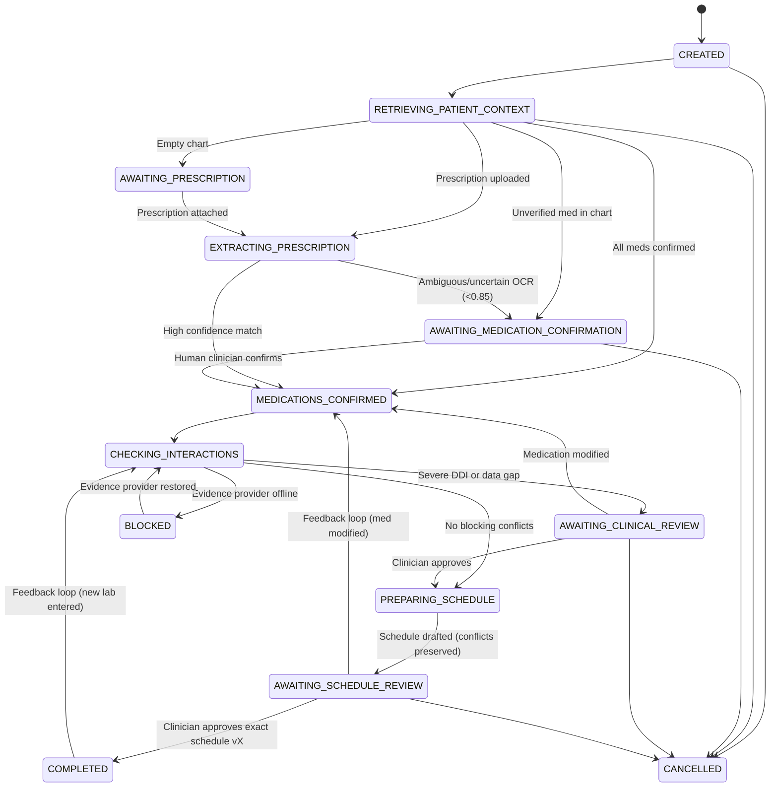
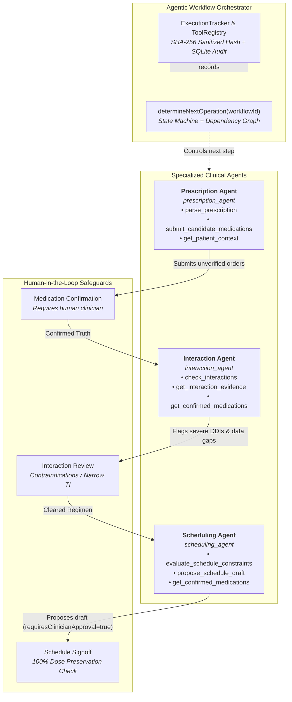
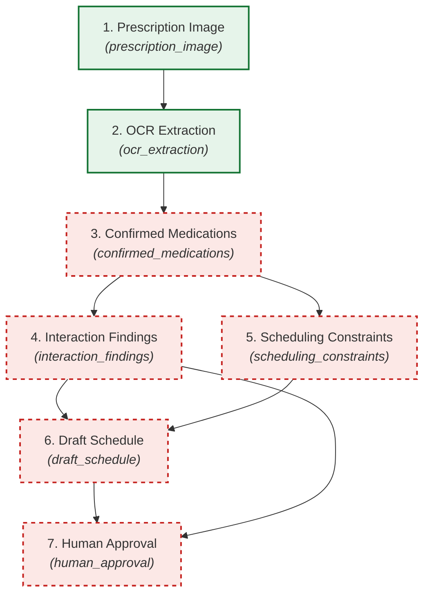
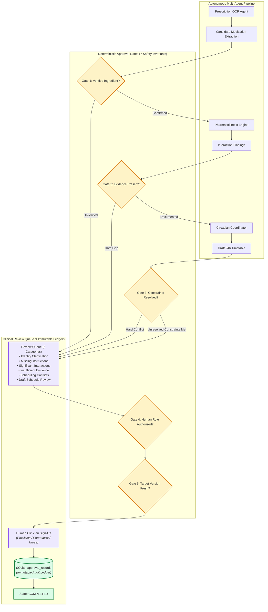
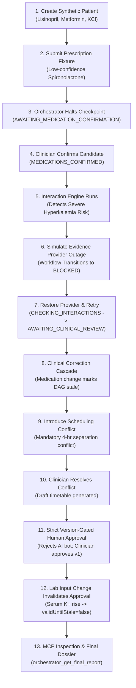

# Polypharmacy Drug-Interaction & Chrono-Dosing Coordinator

> **CLINICAL PROTOTYPE NOTICE:**  
> This system is a **local-first clinical decision-support prototype** for demonstration and architectural evaluation with **synthetic data only**. It is **NOT** a substitute for professional clinical judgment, comprehensive medication reconciliation, or direct physician/pharmacist review. The system does not automatically modify prescriptions or formulate medical advice. Missing values explicitly remain unknown.

---

## Overview

Older adults managing multiple chronic conditions frequently face high-risk polypharmacy regimens characterized by unintentional duplicate active ingredients, severe drug-drug interactions, renal and hepatic clearance thresholds, and suboptimal administration timing.

The **Polypharmacy Drug-Interaction & Chrono-Dosing Coordinator** provides a local-first medication reconciliation and clinical decision-support prototype. It establishes:
1. **Patient Dashboard & Synthetic Geriatric Profiles**: Preloaded with complex polypharmacy scenarios (e.g., dual acetaminophen prescribing, CKD Stage 3b, heart failure, osteoporosis with thyroid hormone absorption conflicts).
2. **Phase 2: Prescription OCR & Normalization Agent**: Local-first optical character extraction and pharmacological entity parsing for printed prescriptions and PDF orders. Features side-by-side source document viewing, field-level confidence scoring, RxNorm terminology mapping, ISMP Look-Alike / Sound-Alike (LASA) hazard detection, and explicit pharmacist reconciliation.
3. **Phase 3: Pharmacokinetic Conflict Engine**: Deterministic clinical rule engine powered by validated, versioned reference datasets. Features drug-pair matching via normalized ingredient IDs, separate PK vs. PD vs. duplicate therapy categorization, established clinical trial vs. theoretical mechanism distinctions, explicit renal/hepatic data gap tracking, grounded LLM explanation scaffolding, and safe provider outage handling.
4. **Granular Medication Data Model**: Captures brand, generic name, active ingredients with individual strengths, salt form, total strength, formulation, route, prescribed dose, frequency, administration instructions, prescriber, and source.
4. **Clinical Context Records**: Allergies, chronic problem list / diagnoses (ICD-10), and renal/hepatic laboratory measurements with units, reference ranges, collection dates, and sources.
5. **Explicit Epistemic Verification States**: Every medication, allergy, diagnosis, and lab measurement maintains an explicit state (`confirmed`, `unverified`, or `unknown`). Missing values remain unknown rather than assumed.
6. **Audited Data Operations**: Every creation, update, verification state toggle, and deletion generates an immutable audit trail entry with actor, timestamp, summary, and previous/new state diffs.
7. **Clinical Calculations & Duplicate Ingredient Engine**: Isolated from UI components; performs alias-aware duplicate ingredient detection, Cockcroft-Gault creatinine clearance (CrCl) estimation, and KDIGO eGFR staging.
8. **Future Agent Service Layer & Typed Contracts**: Defines typed interfaces, data structures, and deterministic prototypes for three future agent services:
   - **Agent 1: `DrugInteractionAgent`**: Evaluates drug-drug interactions, duplicate active ingredients, and drug-allergy contraindications.
   - **Agent 2: `ChronoDosingAgent`**: Optimizes 24-hour circadian administration timelines and flags absorption conflicts (e.g., levothyroxine vs. calcium carbonate).
   - **Agent 3: `RenalHepaticDosingAgent`**: Assesses organ clearance thresholds (e.g., metformin in CKD, NSAIDs, apixaban dose reductions) and AGS Beers Criteria deprescribing opportunities.

---

## Tech Stack

- **Frontend**: React 19, TypeScript, Vite, Tailwind CSS, Lucide Icons
- **Backend**: Node.js, Express, TypeScript, Better-SQLite3
- **Validation**: Zod (shared schemas across client and server)
- **Testing**: Vitest, Supertest
- **Persistence**: SQLite with WAL mode (`data/polypharmacy.db` or in-memory for testing)

---

## Architecture & Code Organization

```
├── package.json                   # Project configuration and script runners
├── tsconfig.json                  # TypeScript config (Client & Shared)
├── tsconfig.server.json           # TypeScript config (Server & API)
├── vite.config.ts                 # Vite bundler configuration & /api proxy
├── tailwind.config.js             # Clinical design theme & color tokens
├── vitest.config.ts               # Test suite runner configuration
├── data/                          # SQLite database storage directory (polypharmacy.db)
├── scripts/
├── src/
│   ├── shared/                    # Shared domain layer (Zero UI dependencies)
│   │   ├── types.ts               # Core TypeScript interfaces & verification enums
│   │   ├── schemas.ts             # Zod validation schemas for all entities
│   │   └── calculations.ts        # Duplicate ingredient detection, CrCl, eGFR formulas
│   ├── server/                    # Backend API layer
│   │   ├── db/
│   │   │   ├── database.ts        # SQLite initialization, schema migrations, pragmas
│   │   │   └── seeds.ts           # Synthetic geriatric patient profiles
│   │   ├── repositories/          # Data access layer
│   │   │   ├── patientRepository.ts
│   │   │   ├── medicationRepository.ts
│   │   │   ├── allergyRepository.ts
│   │   │   ├── diagnosisRepository.ts
│   │   │   ├── labMeasurementRepository.ts
│   │   │   └── auditLogRepository.ts
│   │   ├── services/              # Business logic & Agent services
│   │   │   ├── auditService.ts    # Audit logging & diff computation
│   │   │   ├── patientService.ts  # Comprehensive patient bundle aggregation
│   │   │   └── agents/            # Future agent typed contracts & deterministic stubs
│   │   │       ├── types.ts
│   │   │       ├── drugInteractionAgent.ts
│   │   │       ├── chronoDosingAgent.ts
│   │   │       └── renalHepaticDosingAgent.ts
│   │   ├── routes/                # Express REST endpoints
│   │   ├── middleware/            # Zod validation & consistent error handlers
│   │   ├── app.ts                 # Express application assembly & static fallback
│   │   └── index.ts               # Server bootstrap & graceful shutdown
│   └── client/                    # Frontend React application
│       ├── api/apiClient.ts       # Typed API client
│       ├── components/
│       │   ├── SafetyNotice.tsx           # Persistent clinical prototype banner
│       │   ├── VerificationBadge.tsx      # Interactive confirmed/unverified/unknown badge
│       │   ├── PatientSelector.tsx        # Synthetic profile switcher
│       │   ├── PatientDashboard.tsx       # KPI summaries & tabbed navigation
│       │   ├── MedicationList.tsx         # 12-field medication order table
│       │   ├── MedicationModal.tsx        # Add/Edit medication with Zod validation
│       │   ├── DuplicateIngredientAlert.tsx# Duplicate ingredient hazard banner & details
│       │   ├── AllergyList.tsx & Modal    # Allergy & adverse reaction management
│       │   ├── DiagnosisList.tsx & Modal  # Chronic problem list management
│       │   ├── LabMeasurementList.tsx     # Renal & hepatic panels + CrCl/eGFR readouts
│       │   ├── AuditTrailView.tsx         # Chronological audit ledger with JSON diffs
│       │   └── AgentContractPreview.tsx   # Interactive future agent contract preview
│       ├── App.tsx
│       └── main.tsx
└── tests/
    ├── domain/
    │   ├── calculations.test.ts   # Duplicate detection, Cockcroft-Gault, eGFR tests
    │   └── schemas.test.ts        # Zod validation boundary tests
    └── server/
        ├── repositories.test.ts   # SQLite CRUD & audit persistence tests
        └── api.test.ts            # API routes, error payloads, and agent endpoints
```

---

## Setup & Running Instructions

### Prerequisites
- Node.js >= 18.x (tested on v24.15.0)
- npm >= 9.x

### 1. Install Dependencies
```bash
npm install
```

### 2. Start Development Mode
Runs both the Express backend (port 3001) and Vite frontend (port 5173) concurrently:
```bash
npm run dev
```
Open [http://localhost:5173](http://localhost:5173) in your browser.

### 3. Run Test Suite
Executes all 179 unit and integration tests across 22 test suites via Vitest:
- Domain calculations, Cockcroft-Gault CrCl, eGFR KDIGO staging
- Zod entity validation boundaries & epistemic verification schemas
- SQLite persistence, audit trails, and comprehensive profile aggregation
- Phase 2 local OCR adapter, extraction & normalization layers, and reconciliation endpoints
- Phase 3 ingredient normalization, alias resolution, and duplicate ingredient detection
- Phase 3 deterministic conflict engine, PK vs PD categorization, patient context prerequisites, and safe provider outage handling
- Phase 4 circadian schedule engine, meal synchronization, minimum interval separation, and draft comparisons
- Phase 5 agent orchestration workflows, state machines, and REST endpoints
- Phase 6 security controls, input sanitization, safe path traversal prevention, and rate limits
- Phase 7 MCP server stdio protocol purity, tool dispatchers, and Claude Desktop integration
- Synthetic test harness: database seeding idempotency, reset guardrails, prescription OCR fixtures, clinical interaction fixtures, and circadian schedule scenarios
- MCP synthetic tools integration and benchmark runners

---

## Synthetic Clinical Dataset & Test Harness

The application features a comprehensive, fully synthetic clinical dataset and automated test harness designed specifically for evaluating polypharmacy coordination, drug-drug interaction detection, organ clearance thresholds, and circadian scheduling.

> [!IMPORTANT]
> **SYNTHETIC TEST DATA DISCLAIMER**  
> All patients, medical record numbers, dates, laboratory measurements, prescriptions, and provider names are completely synthetic, fictional test fixtures created for software testing and algorithmic evaluation. They do **NOT** represent real patients or genuine medical records. Prescriptions and instructions must not be interpreted as real medical advice.

### 1. Synthetic Patient Cohort Matrix (8 Diverse Scenarios)

All synthetic patient profiles carry stable IDs (`p1111111...` through `p8888888...`), non-identifying synthetic MRNs (`SYNTH-*`), and are explicitly tagged `SYNTHETIC / TEST DATA` throughout the database and user interface.

| ID | Name | Age / Sex | Synthetic MRN | Care Setting | Key Polypharmacy Scenarios & Test Focus |
|---|---|---|---|---|---|
| `p1` | **Eleanor Vance** | 78F | `SYNTH-10842` | Outpatient Geriatric Clinic | **Duplicate Acetaminophen Hazard**: Co-prescribed Percocet (oxycodone/APAP 5/325 mg) and OTC Tylenol Extra Strength (APAP 1000 mg) across surgical discharge and self-report; unverified newly imported Atorvastatin order. |
| `p2` | **Arthur Pendelton** | 84M | `SYNTH-49211` | Anticoagulation Specialty Care | **Narrow Therapeutic Index & Circadian Polarization**: Warfarin + Amiodarone (CYP2C9 clearance inhibition, INR surge); Furosemide morning placement vs. Zolpidem bedtime placement to prevent nocturnal falls. |
| `p3` | **Margaret Chen** | 72F | `SYNTH-63109` | Outpatient Endocrinology | **Chelation & Absorption Timing Conflict**: Levothyroxine absorption blunted by Calcium Carbonate; Alendronate weekly fasting upright requirement; multi-hour separation constraints. |
| `p4` | **Harold Finch** | 81M | `SYNTH-77340` | Nephrology / Cardiology Care | **Severe Renal Impairment (CKD Stage 4)**: eGFR 24 mL/min, Serum Creatinine 2.8 mg/dL; Metformin lactic acidosis contraindication; Spironolactone hyperkalemia risk (K+ 5.2 mEq/L). |
| `p5` | **Beatrice Holloway** | 76F | `SYNTH-88125` | Hepatology Specialty Care | **Hepatic Impairment / Cirrhosis (Child-Pugh B, MELD-Na 22)**: Total Bilirubin 3.4 mg/dL, Albumin 2.6 g/dL, INR 1.9, Ascites; 100:40 Spironolactone:Furosemide ratio; strict 2 g/day acetaminophen ceiling; hepatic encephalopathy lactulose titration. |
| `p6` | **Walter Sterling** | 88M | `SYNTH-92401` | Primary Care & Urgent Care | **Multi-Prescriber Duplicate NSAID Duplication**: Rheumatology Celecoxib (Celebrex 200 mg) combined with Urgent Care Meloxicam (Mobic 7.5 mg) for acute shoulder sprain; compounding gastrointestinal ulceration risk alongside Apixaban anticoagulation. |
| `p7` | **Evelyn Montgomery** | 69F | `SYNTH-33190` | Outpatient Family Medicine | **Intentional Clinical Data Gap & Ambiguity**: Zero laboratory records on file (testing missing renal baseline safety alert); incomplete sig ("Take as directed"); contradictory meal instructions on OTC iron supplement. |
| `p8` | **Samuel O'Reilly** | 74M | `SYNTH-55823` | Neurology Movement Clinic | **Parkinsonian Dietary Protein Transport Separation**: Carbidopa/Levodopa (Sinemet) competing with dietary amino acids; bedtime Tamsulosin alpha-blocker first-dose syncope prevention; fall-risk psychotropic audit. |

---

### 2. Granular Medication Records (42 Records)

The dataset populates 42 medication records across the 8 test patients, modeling all core pharmacological and administrative dimensions:
- `id`: Stable deterministic identifier (e.g. `med-p1-1` through `med-p8-5`)
- `patient_id`: Foreign key reference to synthetic patient UUID
- `brand` and `generic_name`: Distinct trade and pharmacological designations
- `active_ingredients_json`: Normalized active chemical entities with individual strengths
- `salt`: Chemical salt forms (Hydrochloride, Tartrate, Besylate, Sodium, Dihydrate, Carbonate, etc.)
- `strength` & `formulation`: Dosage form and release characteristics (Extended-Release, Delayed-Release, Solution, Tablet)
- `prescribed_dose`, `route`, & `frequency`: Complete sig components
- `administration_instructions` & `indication`: Meal relations, timing rationale, and clinical context
- `prescriber` & `source`: Prescribing clinician identifier and EHR intake origin
- `verification_status`: Epistemic status (`confirmed`, `unverified`, `unknown`)

---

### 3. Dedicated Synthetic Test Fixtures

#### A. Synthetic Prescription Documents (8 Fixtures in `data/test-fixtures/`)
All test documents are generated programmatically on disk with a prominent **`[SYNTHETIC TEST DATA]`** watermark:
1. `rx_01_clean_printed.png`: High-quality printed baseline prescription (Glucophage XR + Lisinopril).
2. `rx_02_low_quality_scan.png`: Low-resolution blurred mobile/fax scan (< 200 DPI) triggering low optical confidence alert (< 70%).
3. `rx_03_ambiguous_name.png`: ISMP Look-Alike / Sound-Alike (LASA) critical hazard (Celexa vs Celebrex/Zyprexa).
4. `rx_04_missing_dose.png`: Incomplete prescription omitting strength/dose; validates that the system never guesses missing doses.
5. `rx_05_duplicate_brands.png`: Duplicate active ingredient under two trade names (Naprosyn + Anaprox).
6. `rx_06_conflicting_instructions.png`: Contradictory administration instructions ("Take on empty stomach with heavy breakfast meals").
7. `rx_07_missing_frequency.png`: Incomplete signature lacking dosing frequency ("Take 1 tablet").
8. `rx_08_multipage_discharge.pdf`: Multi-medication PDF discharge summary verifying text stream extraction.

#### B. Clinical Interaction Fixtures (12 Scenarios)
1. `fix-ix-01`: Verified-reference match (Apixaban + Naproxen major bleed).
2. `fix-ix-02`: Verified-reference contraindication (Oxycodone + Zolpidem profound CNS/respiratory depression).
3. `fix-ix-03`: Negative control pair absent from rules (Metformin + Levothyroxine; 0 false alerts).
4. `fix-ix-04`: Duplicate active ingredient hazard (Acetaminophen from Percocet + OTC Tylenol).
5. `fix-ix-05`: Duplicate therapeutic class (Celecoxib + Meloxicam dual NSAID therapy).
6. `fix-ix-06`: Uncertain / unmapped ingredient identity (Herbal extract supplement data gap).
7. `fix-ix-07`: Missing clinical prerequisite (Lisinopril + Spironolactone with missing eGFR).
8. `fix-ix-08`: Stale interaction dataset detection (> 180 days since revision).
9. `fix-ix-09`: Reference provider outage resilience (Graceful degraded state without crash).
10. `fix-ix-10`: Theoretical mechanism not promoted to major clinical alert (Atorvastatin + Amlodipine CYP3A4 sharing).
11. `fix-ix-11`: Organ clearance contraindication (Metformin in severe CKD 4).
12. `fix-ix-12`: Physicochemical chelation window (Levothyroxine + Calcium Carbonate >= 4h).

#### C. Circadian Schedule Scenarios (8 Scenarios)
1. `fix-sched-01`: Meal-relative synchronization (Glipizide with morning breakfast).
2. `fix-sched-02`: Circadian polar placement (Morning Furosemide vs Bedtime Zolpidem).
3. `fix-sched-03`: Minimum interval separation (Levothyroxine vs Calcium Carbonate >= 4 hours).
4. `fix-sched-04`: Incompatible timing constraints (Bedtime fasted vs Bedtime with food).
5. `fix-sched-05`: Unresolved food interaction (Grapefruit juice CYP3A4 intestinal avoidance).
6. `fix-sched-06`: Missing prescribed frequency schedule halt.
7. `fix-sched-07`: Schedule construction safety gate (Unverified newly imported orders).
8. `fix-sched-08`: Parkinsonian dietary protein separation (Levodopa dosed 45–60 min before meals).

#### D. Synthetic Renal & Hepatic Laboratory Records (27 Measurements)
Includes normal, abnormal, and missing-data profiles with explicit distinctions between measured laboratory values (serum creatinine, ALT, AST, total bilirubin, serum albumin, potassium) and derived clinical estimates (eGFR, CrCl, Child-Pugh, MELD-Na).

---

### 4. Database Seeding & Safe Reset Operations

The application provides dedicated CLI scripts and API routes for database lifecycle management:

```bash
# Idempotently seed or update synthetic profiles without duplicating records
npm run db:seed

# Reset and re-seed the dedicated test database with safety verification
npm run db:reset
```

#### Safe Reset Guardrails & Invariants:
1. **Mandatory Confirmation Token**: Reset operations require an exact confirmation token (`CONFIRM_RESET_TEST_DATASET`). Any call with missing or incorrect tokens throws a fatal validation error.
2. **Synthetic MRN Isolation**: Reset queries are strictly constrained to records with `SYNTH-` prefixed MRNs (`mrn LIKE 'SYNTH-%'`). Non-synthetic or production patient records are never deleted.
3. **Preservation of Verified Truth**: The idempotent seeder (`seedSyntheticData`) uses `INSERT OR IGNORE`. If a clinician has verified or updated a medication record, subsequent seed runs will never overwrite the clinician's verification status or prescriber annotations.

---

### 5. Developer Synthetic Data Panel (UI)

A developer-only management modal is integrated directly into the React user interface:
- **Header Trigger**: Click the **"Synthetic Test Lab"** button (Beaker icon) in the application header.
- **Cohort Metrics**: Live KPI cards displaying total synthetic patients (8), active medications (42), and laboratory measurements (27).
- **Instant Patient Switcher**: Switch to any of the 8 complex geriatric polypharmacy scenarios in one click.
- **Interactive Fixture Runners**:
  - Run prescription OCR documents through optical extraction and drug normalization.
  - Run pharmacokinetic & pharmacodynamic interaction rules against test scenarios.
  - Run circadian schedule coordinator across meal-relative and temporal separation scenarios.
- **Guarded Reset Modal**: A two-step reset modal requiring literal confirmation input before purging and re-seeding the test dataset.

---

### 6. MCP Integration for Claude Desktop & AI Agents

The Model Context Protocol (MCP) server exposes 6 dedicated synthetic dataset and test tools:
- `list_synthetic_patients`: Lists all 8 synthetic patient profiles and clinical test scenarios.
- `get_synthetic_medications`: Retrieves synthetic medication records with pharmacological details.
- `load_ocr_fixture`: Loads an OCR prescription fixture and executes local normalization.
- `run_interaction_fixture`: Executes conflict engine against interaction test fixtures.
- `run_schedule_fixture`: Tests circadian schedule constraints against schedule scenarios.
- `get_test_results`: Retrieves an aggregated test fixture inventory and verification status.

---
- REST API integration tests for all patient, medication, OCR, and interaction endpoints

```bash
npm test
```

### 4. Run TypeScript Checks
Validates strict type-safety across both frontend and backend configurations:
```bash
npm run typecheck
```

### 5. Build for Production
Compiles the React frontend into `dist/` and compiles the server TypeScript into `dist/server/`:
```bash
npm run build
```

### 6. Start Production Server
Starts the production Express server, serving the SQLite database and the compiled React application on port 3001:
```bash
npm start
```
Open [http://localhost:3001](http://localhost:3001).

---

## Synthetic Patient Scenarios

The system preloads three synthetic profiles illustrating geriatric polypharmacy challenges:

1. **Eleanor Vance (Age 78, Female, MRN: SYNTH-84920)**
   - **Diagnoses**: CKD Stage 3b (eGFR 42 mL/min/1.73m²), Type 2 Diabetes, Hypertension, Knee Osteoarthritis.
   - **Polypharmacy Hazard**: Co-prescribed **Tylenol Extra Strength** (500 mg APAP) and **Percocet 5/325** (325 mg APAP post-arthroscopy).
   - **Clinical Alert**: Duplicate ingredient engine flags cumulative acetaminophen hepatotoxicity hazard; Renal agent warns on Metformin dosing threshold in CKD 3b.

2. **Arthur Pendelton (Age 84, Male, MRN: SYNTH-49211)**
   - **Diagnoses**: Non-valvular Atrial Fibrillation, HFpEF, NASH with elevated transaminases (ALT 68, AST 74), Insomnia.
   - **Medications**: Apixaban, Metoprolol, Furosemide, Zolpidem.
   - **Clinical Alert**: Chrono-Dosing agent requires morning administration for Furosemide to avoid nocturia and fall risk; Organ Clearance agent flags Beers Criteria caution for Zolpidem.

3. **Margaret Chen (Age 72, Female, MRN: SYNTH-92841)**
   - **Diagnoses**: Hypothyroidism, Postmenopausal Osteoporosis, Depression.
   - **Medications**: Levothyroxine (Synthroid 75 mcg), Calcium Carbonate + Vitamin D (Caltrate), Sertraline.
   - **Clinical Alert**: Chrono-Dosing agent detects chelation/absorption interference between Levothyroxine and Calcium Carbonate, requiring a mandatory $\ge 4$-hour separation window.

---

## Phase 2: Prescription OCR & Normalization Agent

Phase 2 introduces a local-first prescription ingestion, optical text extraction, and pharmacological normalization pipeline integrated directly into the patient dashboard.

```
                    ┌────────────────────────────────────────────────────────┐
                    │            Uploaded Prescription Image / PDF           │
                    └───────────────────────────┬────────────────────────────┘
                                                │
                                                ▼
┌───────────────────────────────────────────────────────────────────────────────────────────┐
│ [Layer A] OCR Extraction Service (OCRExtractionService)                                   │
│  - IOCREngine Adapter (LocalOCREngine - Zero third-party cloud calls)                     │
│  - Optical extraction & coordinate preservation (pageNumber, lineIndex, boundingBox)      │
│  - Pharmacological tokenization: brand, dose, salt, formulation, route, frequency, sig    │
│  - Field-level optical confidence scoring & syntax ambiguities (missing dose, bare unit)  │
└───────────────────────────────────────────────┬───────────────────────────────────────────┘
                                                │
                                                ▼
┌───────────────────────────────────────────────────────────────────────────────────────────┐
│ [Layer B] Terminology & Identity Resolution (DrugNormalizationService)                    │
│  - IDrugTerminologyProvider (LocalRxNormTerminologyProvider)                             │
│  - Maps candidates to standard RxNorm concepts, explicit salt forms, and release profiles │
│  - Detects ISMP Look-Alike / Sound-Alike (LASA) safety hazards without silent auto-choice │
│  - Compares candidates against patient active medications to flag duplicate ingredients   │
└───────────────────────────────────────────────┬───────────────────────────────────────────┘
                                                │
                                                ▼
┌───────────────────────────────────────────────────────────────────────────────────────────┐
│ [UI] Side-by-Side Review & Clinical Reconciliation Workspace                              │
│  - Left: Interactive DocumentViewer with zoom & coordinate line highlighting              │
│  - Right: Editable CandidateMedicationCard with confidence drilldown & LASA warnings      │
│  - Manual Entry Fallback modal for unreadable/handwritten scripts                         │
│  - Explicit Clinician Confirmation required to persist record into patient chart + audit  │
└───────────────────────────────────────────────────────────────────────────────────────────┘
```

### Safety Invariants & Clinical Guardrails
1. **Never Infer a Missing Dose**: If a prescription specifies a medication name without strength (e.g. `Rx: Metformin Oral Tablet`), the system refuses to guess a default. It flags a `critical` severity ambiguity (`missing_dose`) requiring clinician resolution.
2. **Never Silently Choose Between LASA Pairs**: Candidate orders matching known Institute for Safe Medication Practices (ISMP) Look-Alike / Sound-Alike pairs (e.g., Celexa vs. Celebrex vs. Zyprexa) flag a `critical` hazard and present alternatives. The system never silently assigns a match.
3. **Never Treat OCR as Verified Truth**: Candidates remain preliminary (`pending_review` / `unverified`) until a clinician explicitly reviews, edits, and confirms the order with their credentials.
4. **Duplicate Active Ingredient Co-Prescription Detection**: Cross-checks candidate active ingredients against the patient's existing active regimen (e.g. discharge `Percocet` containing Acetaminophen against baseline `Tylenol`), alerting before an overdose hazard occurs.
5. **Zero-Cloud Local Privacy Guarantee**: All OCR parsing and terminology resolution run entirely in the local environment. Temporary upload files are stored in `data/uploads/temp/` and can be deleted on demand via `DELETE /api/ocr/documents/:id`.

---

## Phase 3: Pharmacokinetic Conflict Engine

Phase 3 implements a deterministic clinical rule engine that can be assisted by an LLM for explanations, but whose clinical findings originate strictly from validated, versioned reference data and explicit rules.

```
                    ┌────────────────────────────────────────────────────────┐
                    │               Active Patient Medication Regimen        │
                    └───────────────────────────┬────────────────────────────┘
                                                │
                                                ▼
┌───────────────────────────────────────────────────────────────────────────────────────────┐
│ [Provider Layer] Versioned Evidence & Drug Reference (IDrugReferenceProvider)             │
│  - LocalDrugReferenceProvider (v2026.1.0): Normalized ingredients, CYP/P-gp profiles,     │
│    narrow therapeutic index (NTI) flags, clearance pathways, and alias resolution         │
│  - LocalInteractionEvidenceProvider: Explicit rules with publication dates & citations   │
│  - Safe Provider-Unavailable State: Refuses false safety certification during outages     │
└───────────────────────────────────────────────┬───────────────────────────────────────────┘
                                                │
                                                ▼
┌───────────────────────────────────────────────────────────────────────────────────────────┐
│ [Rule Engine] Pharmacokinetic Conflict Engine (PharmacokineticConflictEngine)            │
│  - Category Separation: Pharmacokinetic vs. Pharmacodynamic vs. Duplicate vs. Clearance   │
│  - Evidence Grading: Established Clinical Trial vs. Theoretical Mechanism                 │
│  - Patient Context Evaluation: Conditions on eGFR/CrCl or age ONLY where rule specifies   │
│  - Epistemic Gaps: Flags missing renal/hepatic data and unverified drug identities       │
│  - Stale Dataset Alerting: Flags reference datasets exceeding maintenance threshold       │
└───────────────────────────────────────────────┬───────────────────────────────────────────┘
                                                │
                                                ▼
┌───────────────────────────────────────────────────────────────────────────────────────────┐
│ [Explainability Layer] Explanation & LLM Grounding Scaffolding                            │
│  - Rule-grounded clinician summaries and patient plain-language consultation notes        │
│  - Zero-hallucination LLM scaffolding prompt tethered to verified structured findings     │
│  - Interactive Review Workspace with category filters and production data governance      │
└───────────────────────────────────────────────────────────────────────────────────────────┘
```

### Clinical Constraints & Invariants
1. **No False CYP Sharing Inference**: Does NOT infer a clinically significant interaction merely because two drugs share a CYP enzyme. Atorvastatin and Amlodipine both undergo CYP3A4 metabolism, but the interaction is classified strictly as `minor` with `theoretical_mechanism` evidence and `routine_monitoring` review.
2. **Never Claim Safety From Incomplete Data**: The engine never reports a regimen is safe merely because no interaction was found in a curated or incomplete dataset. Incomplete datasets and clinical data gaps (e.g. missing baseline creatinine) are explicitly flagged.
3. **Explicit Data Gaps Representation**: Missing kidney function (eGFR/CrCl), missing liver transaminases (ALT/AST), and unverified prescription orders are surfaced as actionable `ClinicalDataGap` items rather than assuming normal organ function.
4. **Safe Provider-Unavailable State**: If reference providers experience an outage or disconnection, the engine immediately activates a fail-safe state: it displays a prominent alert and refuses to generate a clean bill of health.
5. **Production Data Sources Governance**: Includes licensing, completeness, and update frequency audits for production data sources (RxNorm UMLS, DailyMed SPL, CPIC Guidelines, CredibleMeds QTDrugs).

---

## Phase 4: Circadian Schedule Coordinator

Phase 4 implements a constraint-based scheduling engine that coordinates medication administration across the 24-hour diurnal cycle using existing medication records, interaction evidence, and patient routine preferences. Clinical timing constraints originate strictly from validated, evidence-backed reference rules without relying on LLM hallucination.

```
                    ┌────────────────────────────────────────────────────────┐
                    │  Confirmed Prescriptions & Patient Routine Preferences │
                    │  (Wake: 07:00, Breakfast: 08:00, Bedtime: 21:30)       │
                    └───────────────────────────┬────────────────────────────┘
                                                │
                                                ▼
┌───────────────────────────────────────────────────────────────────────────────────────────┐
│ [Evidence Rules Layer] Authoritative Circadian & Separation Rules                         │
│  - Diuretic Morning Restriction (08:00): Prevents nocturia, orthostasis, and fall hazard  │
│  - Levothyroxine Morning Fasted (07:00): Mandatory >= 4-hour separation from cations      │
│  - Multivalent Cations (Calcium/Iron): Scheduled with Lunch (12:30) & Dinner (18:30)     │
│  - Short-Acting Statins (Simvastatin) & Sedative-Hypnotics (Zolpidem): Bedtime (21:30)    │
│  - Mucosal Irritants (Metformin, NSAIDs): Scheduled with or immediately after meals       │
│  - Systemic PK Invariant: Warns that spacing does NOT resolve CYP/P-gp enzyme inhibition  │
└───────────────────────────────────────────────┬───────────────────────────────────────────┘
                                                │
                                                ▼
┌───────────────────────────────────────────────────────────────────────────────────────────┐
│ [Scheduling Engine] Circadian Schedule Coordinator (CircadianScheduleCoordinator)         │
│  - SAFETY INVARIANT: Strictly preserves prescribed doses, frequencies, and formulations   │
│  - Computes validated meal-relative timing windows (empty_stomach, with_meal, bedtime)    │
│  - Detects impossible/contradictory constraints (e.g. bedtime diuretics, cation clashes)  │
│  - Evaluates epistemic uncertainty: unverified orders flagged with low confidence         │
│  - PRN medications preserved in flexible as-needed status without forced daily slots      │
└───────────────────────────────────────────────┬───────────────────────────────────────────┘
                                                │
                                                ▼
┌───────────────────────────────────────────────────────────────────────────────────────────┐
│ [Clinical Review & Audit Layer] Workspace, Comparison Table & SQLite Persistence          │
│  - 24-Hour Visual Timetable: Expandable rationale cards with source citations             │
│  - Side-by-Side Comparison: Prescribed baseline vs. Draft timetable with diff status      │
│  - Patient Routine Customizer: Modifies wake, meal, and bed hours with auto-recalculation │
│  - Formal Clinician Review Dialog: Accept / Reject / Modify with mandatory audit log      │
│  - Complete Audit Trail: Persists schedule revisions in `chrono_schedules` & `audit_logs` │
└───────────────────────────────────────────────────────────────────────────────────────────┘
```

### Safety Invariants & Clinical Guardrails
1. **Strict Prescription Integrity Invariant**: The engine **never** modifies prescribed doses, frequencies, or formulations. For example, twice-daily Metformin 500 mg is scheduled as two distinct 500 mg doses at breakfast and dinner; it is never consolidated into 1000 mg or altered in strength.
2. **Systemic Metabolic PK Interaction Non-Separation Warning**: Temporal spacing of administration times does **not** resolve systemic metabolic interactions (e.g., CYP3A4/P-gp inhibition by Clarithromycin with Apixaban). The scheduler raises an urgent clinical alert explicitly stating that systemic enzyme inhibition persists throughout the 24-hour interval and requires alternative drug selection or dosage reduction, not time spacing.
3. **Nocturnal Diuretic Fall-Risk Prevention**: Diuretics (Furosemide, Bumetanide, Hydrochlorothiazide) prescribed near bedtime are flagged as urgent clinical hazards. The engine automatically moves the proposed draft dose to the morning breakfast slot (08:00) to prevent nocturnal polyuria, sleep fragmentation, and catastrophic fall/hip fractures in older adults.
4. **Mandatory Chelation Separation ($\ge 4$ hours)**: Levothyroxine requires gastric acidity and is scheduled on waking fasted ($\ge 60$ min before breakfast). Multivalent cations (Calcium Carbonate, Ferrous Sulfate) are scheduled with lunch (12:30) and dinner (18:30), satisfying the authoritative 4-hour temporal separation requirement.
5. **Epistemic Data Gaps & Low Confidence**: Any medication with unverified status (e.g., preliminary OCR intake) is flagged with `low` confidence and surfaced in the unconfident medications registry. The draft schedule explicitly alerts that clinician verification is required before adoption.
6. **Immutable Audit Trail**: Every schedule generation, routine preference update, and clinician review decision (accepted, rejected, or modified) is persisted in the SQLite `chrono_schedules` and `audit_logs` tables with reviewer credentials, timestamp, and clinical rationale.

### REST Endpoints
- `GET /api/chrono/patient/:patientId/draft`: Generates or retrieves the latest draft 24-hour timetable, side-by-side comparison, and unresolved conflicts.
- `GET /api/chrono/patient/:patientId/routine`: Retrieves the patient's daily meal and sleep routine.
- `PUT /api/chrono/patient/:patientId/routine`: Updates the daily routine, logs an audit entry, and recalculates the draft timetable.
- `POST /api/chrono/patient/:patientId/review`: Submits clinician review decision (`accepted`, `rejected`, `modified`) with rationale and logs an audit record.
- `GET /api/chrono/patient/:patientId/history`: Retrieves the audit history of all past schedule iterations and reviews.

---

## Duplicate-Ingredient Detection Engine

Clinical calculations are maintained in [src/shared/calculations.ts](file:///c:/Users/music/OneDrive/Desktop/Polypharmacy%20Drug-Interaction%20%26%20Chrono-Dosing%20Coordinator/src/shared/calculations.ts).

### Algorithm:
1. Normalizes pharmaceutical ingredient names and aliases (e.g., `Paracetamol` $\to$ `acetaminophen`, `APAP` $\to$ `acetaminophen`, `ASA` $\to$ `aspirin`, `HCTZ` $\to$ `hydrochlorothiazide`).
2. Iterates active, held, and PRN medication orders for the patient.
3. Groups medications sharing normalized chemical entities.
4. If an ingredient appears in $\ge 2$ active medications, calculates cumulative toxicity severity (`high` for narrow therapeutic indices or black-box hepatotoxic/nephrotoxic ingredients like acetaminophen, opioids, and NSAIDs).
5. Produces clinical rationale without fabricating medical advice.

---

## Future Agent Service Contracts (Phase 1 Stubs)

The system exposes clean, typed service contracts and deterministic endpoints under `/api/agents`:

| Agent | Interface | Endpoint | Deterministic Logic |
| :--- | :--- | :--- | :--- |
| **Drug Interaction Agent** | `IDrugInteractionAgentService` | `GET /api/agents/interactions/:patientId` | Duplicate ingredients, verified major DDIs (e.g., Apixaban + NSAID, Opioid + Sedative), documented allergy cross-reactions. |
| **Chrono-Dosing Coordinator** | `IChronoDosingAgentService` | `GET /api/agents/chrono-dosing/:patientId` | Circadian slots (Morning fasted, Breakfast, Midday, Dinner, Bedtime, PRN), absorption conflicts (Levothyroxine vs. Calcium), nocturnal fall risk prevention (morning diuretics). |
| **Renal/Hepatic Clearance Agent** | `IRenalHepaticDosingAgentService` | `GET /api/agents/organ-clearance/:patientId` | Cockcroft-Gault CrCl estimation, KDIGO eGFR staging, Metformin renal cutoff ($< 30$ and $30-44$ mL/min), AGS Beers Criteria deprescribing prompts. |

---

## Phase 5: Agent Orchestration Engine

The typed workflow orchestrator connects the 3 modular clinical agent services into an end-to-end coordinated pipeline governed by a 6-stage finite state machine:

```
[IDLE]
  │
  ▼
[STAGE 1: FETCHING_PATIENT_RECORDS] (Retrieves active meds, problem list, labs)
  │
  ▼
[STAGE 2: OCR_INTAKE] (Optional: triggered when new prescription image/PDF is supplied)
  │
  ▼
[STAGE 3: AWAITING_MEDICATION_CONFIRMATION] (Epistemic Checkpoint: pauses if unverified orders exist)
  │
  ▼
[STAGE 4: EVALUATING_INTERACTIONS] (Deterministic PK Conflict Engine)
  │
  ▼
[STAGE 5: COORDINATING_SCHEDULE] (Diurnal Chrono-Coordinator with 100% dose preservation)
  │
  ▼
[STAGE 6: GENERATING_CONSOLIDATED_REPORT] (Synthesizes clinical dossier & prioritized pharmacist actions)
  │
  ▼
[COMPLETED]
```

### Orchestration Safety Invariants:
1. **Epistemic Checkpoints**: If `requireConfirmedOnly: true` and any active prescription has `verificationStatus !== 'confirmed'`, the workflow transitions to `PAUSED_FOR_CLINICAL_REVIEW`. The pipeline halts to prevent false interaction clearance on preliminary data. Clinicians confirm identities via the UI or `POST /api/orchestration/run/:runId/resume`.
2. **Sanitized Execution Logs**: Workflow logs contain no raw base64 images, no buffer strings, no SQL credentials, and no unredacted personal identifiers.
3. **Deterministic Core with LLM Assistance**: Computations (drug-pair matching, CYP/P-gp clearance, circadian time-slotting) are 100% deterministic code. LLMs provide explanatory text scaffolding only and cannot invent timing constraints or silently discard interactions.
4. **Idempotent Runs & Timeouts**: Runs are cached by `runId` and configurable timeouts default to 10,000ms, failing safely to `FAILED_RECOVERABLE` on timeout or dependency error.

---

## Phase 6: Clinical Dashboard & Safety Hardening

### Holistic Clinical Dashboard
- **Consolidated Dossier Tab**: Executive summary of patient demographics, active confirmed regimen, and complete diagnostic context.
- **Prioritized Pharmacist Review Checklist**: Categorizes actions into `immediate_action` (e.g. duplicate active ingredients, severe DDIs), `pre_administration_signoff` (e.g. 4-hour absorption spacing, bedtime sedative fall hazards), and `routine_monitoring` (e.g. organ clearance gaps).
- **Diurnal Circadian Schedule**: 24-hour diurnal administration timetable displaying 100% prescribed dose preservation and timing rationales.
- **Dataset Provenance Ledger**: Tracks version numbers of the orchestrator, conflict engine, circadian coordinator, and reference datasets.

### Security Hardening & Data Governance
1. **Strict Local-Only Storage**: All patient data, prescription images, and SQLite databases remain strictly local on the deployment machine (`data/`).
2. **Path Traversal Guards (`validateSafePath`)**: Blocks directory traversal (`../`, `..\\`), null-byte injections (`%00`, `\0`), and path escapes outside the designated application boundaries.
3. **Filename Sanitization (`sanitizeFilename`)**: Strips unsafe POSIX and Windows filesystem characters (`<>:"/\|?*`).
4. **Scoped MCP Tools (`/api/orchestration/mcp/call`)**: Strictly allows 6 registered clinical tools validated by Zod (`get_patient_overview`, `get_confirmed_medications`, `run_interaction_analysis`, `get_circadian_timetable`, `get_consolidated_clinical_report`, `confirm_medication_order`). Prohibits arbitrary shell/command execution (`execute_command`, `read_arbitrary_file`, `eval`, `system_shell`).
5. **Confirmation-Token Guarded Mutations**:
   - Medication order confirmation requires token: `"CONFIRM_MUTATION"`.
   - Patient record purge requires exact token: `"PURGE_{patientId}"`.
6. **GDPR / HIPAA Data Portability & Purge**:
   - `GET /api/governance/patient/:patientId/export`: Downloads a complete JSON patient dossier with `Content-Disposition: attachment`.
   - `POST /api/governance/patient/:patientId/purge`: Deletes patient records across all clinical tables while recording a permanent de-identified `PURGE` event in the immutable audit ledger.

---

## Verification & Epistemic States

Every clinical entity records a `verificationStatus`:
- `confirmed`: Verified against discharge summaries, lab panels, or prescriber confirmation.
- `unverified`: Preliminary order, self-reported intake, or unconfirmed allergy.
- `unknown`: Explicitly unconfirmed or missing provenance.

Clinicians can toggle states with one click in the UI, instantly writing a `STATUS_CHANGE` entry to the SQLite audit trail.

---

## Design & Accessibility

- Adheres to good design principles: unobtrusive, honest, down to the last detail, and minimal.
- High-contrast clinical typography using slate and clinical teal palettes with WCAG AA compliance.
- Semantic HTML tags (`<main>`, `<nav>`, `<aside>`, `<article>`, `<dialog>`), keyboard navigation, and explicit `aria-label` attributes.
- Semantic HTML tags with accessibility-first approach and WCAG AA compliance auditing.

---

## Test Suite & Verification Results

The test suite covers domain calculations, Zod schemas, SQLite repositories, REST endpoints, OCR extraction, terminology mapping, LASA warnings, Pharmacokinetic conflict engine, circadian coordination, workflow orchestration state machine, scoped MCP tools, filesystem path traversal guards, and GDPR data governance:

```bash
npm test
```

### Actual Test Run Results:
```
 ✓ tests/interactions/conflictEngine.test.ts (11 tests)
 ✓ tests/ocr/extractionAndNormalization.test.ts (7 tests)
 ✓ tests/orchestration/workflowCoordinator.test.ts (7 tests)
 ✓ tests/server/repositories.test.ts (3 tests)
 ✓ mcp-server/tests/toolHandlers.test.ts (19 tests)
 ✓ tests/ocr/ocrEngine.test.ts (7 tests)
 ✓ tests/domain/calculations.test.ts (8 tests)
 ✓ tests/interactions/interactionApi.test.ts (8 tests)
 ✓ tests/security/safetyAndGovernance.test.ts (9 tests)
 ✓ tests/server/api.test.ts (9 tests)
 ✓ tests/ocr/ocrApi.test.ts (7 tests)
 ✓ tests/chrono/chronoApi.test.ts (9 tests)
 ✓ tests/orchestration/orchestrationApi.test.ts (12 tests)
 ✓ mcp-server/tests/mcpProtocol.test.ts (7 tests)
 ✓ tests/domain/schemas.test.ts (6 tests)
 ✓ tests/chrono/scheduleEngine.test.ts (8 tests)
 ✓ tests/interactions/normalizationAndMatching.test.ts (6 tests)

 Test Files  17 passed (17)
      Tests  143 passed (143)
```

---

## Setup & Running the Application

### 1. Install Dependencies
```bash
npm install
```

### 2. Run TypeScript Typechecks
```bash
npm run typecheck
```

### 3. Run Test Suite
```bash
npm test
```

### 4. Build for Production
```bash
npm run build
```

### 5. Start Development Server
```bash
npm run dev
```
- Client runs at: `http://localhost:5173`
- Server API runs at: `http://localhost:3001`

---

## Phase 7: Local MCP Server for Claude Desktop & LLM Agents

The **Polypharmacy Coordinator MCP Server** exposes the clinical decision-support engines directly to Anthropic's Claude Desktop and other Model Context Protocol (MCP) clients over a local `stdio` JSON-RPC 2.0 transport.

### Architectural Invariants & Protocol Purity
1. **Zero Business Logic Duplication**: Reuses the validated domain repositories (`PatientRepository`, `MedicationRepository`), deterministic engines (`PharmacokineticConflictEngine`, `CircadianScheduleCoordinator`), and security guards (`validateSafePath`, `AuditService`).
2. **Strict Stdio Transport Purity**: All diagnostic, startup, and error logging is routed strictly to `process.stderr`. `process.stdout` is exclusively dedicated to valid JSON-RPC 2.0 protocol frames.
3. **No Clinical Hallucinations**:
   - `get_clinical_evidence` queries versioned reference rules; it never synthesizes or fabricates citations.
   - `propose_medication_schedule` strictly preserves 100% of prescribed doses and frequencies; it returns a draft timetable only.
   - `confirm_medication` requires an explicit security guard token (`"CONFIRM_MUTATION"`) and creates an immutable SQLite audit log entry with diff tracking.
   - Missing lab values and unverified medications remain explicitly flagged as unknown or unverified.

---

### Registered MCP Tools

| Tool Name | Description | Key Parameters | Epistemic Safeguard |
|---|---|---|---|
| `list_patients` | Lists all authorized geriatric patients with MRNs, care settings, and birth dates. | `search` *(optional)* | Minimal synthetic identifiers only. |
| `get_patient_medications` | Retrieves active medication regimen for a patient record. | `patientId` *(required)*, `confirmedOnly` *(default: true)* | Flags unverified medications with warning notices. |
| `parse_prescription` | Processes a prescription image (PNG/JPEG/WEBP) or PDF via local OCR. | `filePath` *(required)*, `patientId` *(optional)* | Confined to `data/`; path traversal attacks are blocked. Returns candidate status only. |
| `get_interaction_report` | Runs deterministic PK/PD evaluation against active meds, labs, and diagnoses. | `patientId` *(required)* | Identifies duplicate active ingredients, severe DDIs, and organ clearance gaps. |
| `get_clinical_evidence` | Retrieves authentic clinical trial citations and guidelines for an ingredient pair or finding. | `ingredientPair` or `findingId` | Never invents citations or clinical literature. |
| `propose_medication_schedule` | Generates a 24-hour draft timetable resolving food/fasting and interval constraints. | `patientId` *(required)* | 100% dose/formulation preservation; draft-only watermark. |
| `get_review_status` | Summarizes workflow orchestration state, unconfirmed orders, and high-priority action items. | `patientId` *(required)* | Explicitly identifies pending clinical confirmations. |
| `confirm_medication` | Clinician-authorized state change marking an order as verified clinical truth. | `medicationId`, `actor`, `confirmationToken`, `justification` | Guarded by `"CONFIRM_MUTATION"`; records audit log. |
| `get_patient_review_report` | Compiles a full consolidated clinical dossier for multidisciplinary review. | `patientId` *(required)* | Structured report with data gaps, conflicts, and provenance. |
| `list_synthetic_patients` | Lists all 8 synthetic test cohort patients with scenario summaries, clinical focus, and non-identifying IDs. | `scenarioFilter` *(optional)* | All records strictly tagged `SYNTHETIC / TEST DATA`. |
| `get_synthetic_medications` | Retrieves synthetic medication records for a test patient including pharmacological properties, prescribers, and status. | `patientId` *(required)* | Preserves explicit synthetic provenance and clinical indications. |
| `load_ocr_fixture` | Loads a prescription fixture from `data/test-fixtures/`, executes local OCR and drug normalization, and compares against assertions. | `fixtureId` *(required)* | Operates exclusively on pre-generated synthetic test fixtures. |
| `run_interaction_fixture` | Executes PK/PD conflict engine against a synthetic interaction test scenario, verifying rule matching and data gaps. | `fixtureId` *(required)* | Explicit hypothetical test rule assertions; no fabricated clinical facts. |
| `run_schedule_fixture` | Runs circadian coordinator on a synthetic schedule scenario, asserting interval separation, meal timing, and conflict gates. | `scenarioId` *(required)* | Validates deterministic chrono-rules without altering patient regimen. |
| `get_test_results` | Retrieves aggregated synthetic test fixture inventory and verification status across OCR, interaction, and schedule scenarios. | `category` *(all/ocr/interaction/schedule)* | Summarizes test harness health and coverage metrics. |

---

### Windows Claude Desktop Configuration Guide

To connect Claude Desktop on Windows to the Polypharmacy Coordinator MCP Server:

1. Open your Claude Desktop configuration file located at:
   `%APPDATA%\Claude\claude_desktop_config.json`
   *(e.g., `C:\Users\<username>\AppData\Roaming\Claude\claude_desktop_config.json`)*

2. Add the `polypharmacy-coordinator` server definition using either the **pre-built bundle** (recommended) or the **direct TypeScript execution**:

#### Option A: Pre-built Bundle (Recommended)
First build the production bundle:
```bash
npm run build:mcp
```
Then configure `claude_desktop_config.json`:
```json
{
  "mcpServers": {
    "polypharmacy-coordinator": {
      "command": "node",
      "args": [
        "C:\\Users\\music\\OneDrive\\Desktop\\Polypharmacy Drug-Interaction & Chrono-Dosing Coordinator\\mcp-server\\dist\\index.js"
      ]
    }
  }
}
```

#### Option B: Direct TypeScript Execution (Development)
```json
{
  "mcpServers": {
    "polypharmacy-coordinator": {
      "command": "node",
      "args": [
        "C:\\Users\\music\\OneDrive\\Desktop\\Polypharmacy Drug-Interaction & Chrono-Dosing Coordinator\\node_modules\\tsx\\dist\\cli.mjs",
        "C:\\Users\\music\\OneDrive\\Desktop\\Polypharmacy Drug-Interaction & Chrono-Dosing Coordinator\\mcp-server\\src\\index.ts"
      ]
    }
  }
}
```

3. Restart Claude Desktop. The hammer/tools icon will display all 9 registered clinical tools.

---

### Example Interaction Prompts for Claude Desktop

Once connected, you can prompt Claude to coordinate clinical decision-support:

- **Patient Overview**:  
  *"List all patients currently managed by the Polypharmacy Coordinator and check their care settings."*

- **Interaction & Clearance Analysis**:  
  *"Run an interaction report for Arthur Pendelton. Are there any contraindicated drug combinations or missing renal measurements?"*

- **Circadian Optimization**:  
  *"Margaret Chen takes levothyroxine and calcium carbonate. Propose a draft circadian schedule and verify that their administration times are separated."*

- **Authentic Evidence Lookup**:  
  *"Retrieve the clinical evidence citation for the interaction between apixaban and clarithromycin from the reference database."*

- **Prescription Intake**:  
  *"Parse the local prescription document at `data/test-fixtures/synthetic-rx.png` and report any Look-Alike / Sound-Alike (LASA) warnings."*

- **Clinical Order Confirmation**:  
  *"Confirm the unverified medication order for Eleanor Vance after reviewing her discharge summary, using confirmation token CONFIRM_MUTATION."*

---

### Troubleshooting Windows Claude Desktop Integration

- **MCP Server Fails to Launch**: Verify that Node.js is on your Windows PATH (`node -v` in PowerShell). Double-check that Windows backslashes in `claude_desktop_config.json` are escaped as double backslashes (`\\\\`).
- **Path Traversal Errors on Prescription Parsing**: The MCP server restricts file paths to the application repository boundary. Prescription images should be placed within the `data/` directory.
- **Unverified Records Warning**: If Claude reports an interaction or schedule gap, check `get_review_status` to see if preliminary intake orders require clinician verification via `confirm_medication`.

---

## Agentic Architecture: Deterministic Workflow Orchestrator

The system includes a deterministic, state-aware multi-agent workflow orchestrator that coordinates three specialized agents:
1. **Prescription OCR & Normalization Agent** (`LocalOCREngine` + `DrugNormalizationService`)
2. **Pharmacokinetic Conflict Engine** (`PharmacokineticConflictEngine` + `LocalInteractionEvidenceProvider`)
3. **Circadian Schedule Coordinator** (`CircadianScheduleCoordinator` + `ChronoService`)

The orchestrator enforces conditional state transitions, validation boundaries, evidence availability, and human clinician checkpoints rather than relying on an unconstrained sequence of LLM prompts.



### 1. Workflow State Machine States

The orchestrator defines 14 explicit states (`AgenticWorkflowState`):

| State | Epistemic Significance & Gating Rule |
| :--- | :--- |
| `CREATED` | Initialized run. Awaiting patient context intake. |
| `RETRIEVING_PATIENT_CONTEXT` | Ingests patient chart, diagnoses, labs, and active medications. |
| `AWAITING_PRESCRIPTION` | Awaiting prescription image/PDF source upload. |
| `EXTRACTING_PRESCRIPTION` | Processing document via local OCR and drug normalization. |
| `AWAITING_MEDICATION_CONFIRMATION` | **Epistemic Truth Checkpoint**: Halts downstream execution if OCR confidence < 0.85, name is ambiguous, dose is missing, or chart contains unverified orders. |
| `MEDICATIONS_CONFIRMED` | All medication entities and prescribed doses are verified as true. Prerequisite for interaction analysis. |
| `CHECKING_INTERACTIONS` | Executes deterministic pharmacokinetic and pharmacodynamic conflict engine. |
| `AWAITING_CLINICAL_REVIEW` | Halts for pharmacist/physician review when severe interactions or organ clearance gaps are detected. |
| `PREPARING_SCHEDULE` | Evaluates circadian constraints and generates 24-hour diurnal dosing timetable. |
| `AWAITING_SCHEDULE_REVIEW` | Preserves timing conflicts (e.g. bedtime diuretic hazard, chelation) for explicit human signoff. |
| `COMPLETED` | All operational steps and human signoffs satisfied. Distinguishes operational completion from clinical approval. |
| `BLOCKED` | A required external dependency (e.g., evidence provider) is unavailable; prevents unsupported clinical inferences. |
| `FAILED` | An unrecoverable error occurred during execution. |
| `CANCELLED` | Explicitly aborted by an authorized clinician. |

### 2. Typed Tool Registry & Security Sandbox

All operations are executed through a typed `ToolRegistry` with Zod input validation, output schema enforcement, expected failure mode mapping, and authorization policies:

| Tool Name | Type | Authorization | Description |
| :--- | :--- | :--- | :--- |
| `get_patient_context` | Read-only | `authenticated_user` | Retrieves patient demographics, diagnoses, and baseline labs. |
| `get_confirmed_medications`| Read-only | `authenticated_user` | Filters active medications to verified truth only. |
| `parse_prescription` | Read-only | `authenticated_user` | Runs sandboxed OCR extraction with path traversal protection. |
| `confirm_medication` | Mutating | `clinician_only` | Updates order verification status. Requires `CONFIRM_MUTATION` token and human identity. |
| `check_interactions` | Read-only | `authenticated_user` | Deterministic PK/PD evaluation against confirmed medications and labs. |
| `get_interaction_evidence`| Read-only | `authenticated_user` | Retrieves authoritative, un-fabricated clinical trial evidence. |
| `evaluate_schedule_constraints` | Read-only | `authenticated_user` | Proposes 24h timetable and flags circadian conflicts. |
| `create_review_request` | Mutating | `authenticated_user` | Records formal human review items. |
| `get_workflow_status` | Read-only | `authenticated_user` | Inspects state, version, and completed/failed operations. |

**Prohibited Tools**: The registry strictly rejects arbitrary shell commands, eval, raw SQL, unrestricted filesystem read/write, or script execution (`eval`, `system_shell`, `execute_command`, `write_file`, `read_arbitrary_file`, `raw_sql`).

### 3. Shared State (`WorkflowContext`) & Optimistic Concurrency

Workflow state is persisted in SQLite (`workflow_contexts` and `review_requests` tables) and maintains strict categorical boundaries:

- **Raw Extracted Data**: Unprocessed OCR tokens, raw text, and candidate entities with confidence scores.
- **User-Confirmed Data**: Orders verified by a licensed clinician against the clinical problem list.
- **Verified Reference Data**: Authoritative RxNorm concept IDs and curated monographs.
- **Derived Findings**: Calculated PK/PD interactions, duplicate chemical entities, and clearance gaps.
- **Proposed Schedules**: Diurnal dosing timetables and preserved timing conflicts.
- **Human-Approved Outcomes**: Clinical overrides, rationales, and signed-off timetables.

**Optimistic Concurrency Control**: Every context mutation increments `version`. Updates verify `WHERE id = ? AND version = ?`. Concurrent updates colliding on the same version throw an `OptimisticConcurrencyError` to prevent race conditions and lost clinical overrides.

### 4. Controlled Feedback Loops & Invalidation Engine

When upstream clinical facts change, the `FeedbackEngine` invalidates downstream derived results without requiring a full manual system reset:

- **Medication Corrections**: When a dose or identity is corrected, all operations tagged with `medication:<id>` (and dependent schedules) are marked `invalidated`. Findings are cleared, prior schedule approvals are invalidated, and state transitions to `MEDICATIONS_CONFIRMED`.
- **New Laboratory Data**: When new renal/hepatic values (e.g., eGFR, Serum Creatinine) are entered, only findings depending on `lab:<testName>` are invalidated. Unaffected findings are preserved.
- **Dataset Versioning**: Tracks dataset versions (`dataset:interactions:2026.1`). If guidelines or reference tables update, old findings are marked stale.
- **Retry Limits & Deduplication**: Recoverable errors can be retried up to 3 times (`MAX_OPERATION_RETRIES`). Identical operations with unchanged input hashes and dependencies reuse results to prevent duplicate execution.

### 5. Human-in-the-Loop Controls & Versioned Approvals

The `ReviewRequestService` manages escalations across 6 categories:
1. `medication_identity_clarification`
2. `missing_prescription_instructions`
3. `potentially_significant_interaction`
4. `insufficient_clinical_evidence`
5. `conflicting_scheduling_constraints`
6. `schedule_review`

**Safety Rules**:
- **Versioned Approval**: An approval must specify the exact version of the item reviewed (`targetVersion === itemVersion`). If underlying data changed in the interim, approval is rejected with `ApprovalVersionMismatchError`.
- **Approval Invalidation**: If a medication or schedule is modified after approval, prior approvals are automatically marked `invalidated`.
- **AI Impersonation Prevention**: Reviewer identity is strictly validated. Autonomous LLM/AI actors (`llm`, `assistant`, `gpt`, `bot`, empty identity) are strictly prohibited from approving clinical reviews.

### 6. REST API Endpoints

The orchestrator exposes the following endpoints under `/api/orchestration/agentic`:

| Method | Endpoint | Description |
| :--- | :--- | :--- |
| `POST` | `/api/orchestration/agentic/workflows` | Creates a new workflow context for a patient. |
| `GET` | `/api/orchestration/agentic/workflows/:workflowId` | Retrieves current workflow context, operations, and review items. |
| `POST` | `/api/orchestration/agentic/workflows/:workflowId/advance` | Steps the workflow to the next permitted operational state. |
| `POST` | `/api/orchestration/agentic/workflows/:workflowId/confirm-candidate` | Human clinician confirms an unverified OCR candidate. |
| `POST` | `/api/orchestration/agentic/workflows/:workflowId/reviews/:reviewId/resolve` | Resolves a review request with versioned human signoff. |
| `POST` | `/api/orchestration/agentic/workflows/:workflowId/correct-medication` | Triggers medication feedback invalidation loop. |
| `POST` | `/api/orchestration/agentic/workflows/:workflowId/record-lab` | Triggers lab measurement feedback invalidation loop. |
| `GET` | `/api/orchestration/agentic/tools` | Lists all registered tools with schemas and policies. |
| `POST` | `/api/orchestration/agentic/tools/call` | Executes a registered tool with authorization and Zod validation. |

---

## Phase 2: Agent Tool Contracts, Capability Declarations & MCP Integration

Phase 2 establishes typed tool contracts and explicit capability declarations for the three specialized agents, extends the deterministic state orchestrator with a dynamic operation selector (`determineNextOperation`), introduces immutable execution audit logging with sanitized input hashing, and enables seamless tool invocation and workflow inspection from Claude Desktop via MCP.

### 1. Specialized Agent Capability Declarations

Each agent operates within an explicitly declared boundary with typed preconditions, postconditions, permitted tools, and human approval policies:



#### A. Prescription OCR & Normalization Agent (`prescription_agent`)
- **Role**: Ingests prescription documents and images, runs optical character recognition, and normalizes candidate medication orders against RxNorm standard entities.
- **Permitted Tools**: `parse_prescription`, `submit_candidate_medications`, `get_patient_context`, `get_workflow_status`.
- **Prohibited Tools**: `confirm_medication`, `check_interactions`, `propose_schedule_draft`, `resolve_review_request`.
- **Preconditions**: Target patient exists; input file path is validated within sandboxed upload directory.
- **Postconditions**: Generates candidate orders with status strictly set to `unverified`. Automatically creates review requests for ambiguous or low-confidence extractions (<0.85) or missing required dosage/frequency instructions.
- **Human Approval Policy**: Explicit human clinician or pharmacist verification is mandatory before candidate orders can enter the confirmed active regimen.

#### B. Pharmacokinetic Conflict Engine Agent (`interaction_agent`)
- **Role**: Executes deterministic pharmacokinetic and pharmacodynamic interaction screening across confirmed active regimens, renal/hepatic biomarkers, and chronic diagnoses. Retrieves authoritative clinical trial citations and KDIGO/FDA guidance.
- **Permitted Tools**: `check_interactions`, `get_interaction_evidence`, `get_confirmed_medications`, `get_patient_context`, `get_workflow_status`.
- **Prohibited Tools**: `confirm_medication`, `submit_candidate_medications`, `propose_schedule_draft`, `resolve_review_request`.
- **Preconditions**: All evaluated medications have `verificationStatus = 'confirmed'`. Reference datasets (FDA DDI, KDIGO) are online.
- **Postconditions**: Produces categorized findings (contraindicated, major, moderate, minor), duplicate active therapy alerts, and clearance data gaps. Strictly unaltered deterministic output from the conflict engine; cannot inject fabricated findings.
- **Human Approval Policy**: Mandatory clinical review request for contraindicated or major interactions, narrow therapeutic index drugs, and renal clearance gaps.

#### C. Circadian Schedule Coordinator Agent (`scheduling_agent`)
- **Role**: Evaluates chronological dosing constraints, food-drug absorption relationships, and diurnal patient routines to propose a 24-hour administration draft.
- **Permitted Tools**: `evaluate_schedule_constraints`, `propose_schedule_draft`, `get_confirmed_medications`, `get_patient_context`, `get_workflow_status`.
- **Prohibited Tools**: `confirm_medication`, `submit_candidate_medications`, `check_interactions`, `resolve_review_request`.
- **Preconditions**: All active medications are confirmed truth; patient diurnal routine is recorded; interaction screening is evaluated.
- **Postconditions**: Proposes a 24-hour administration draft preserving 100% of prescribed doses, formulations, and instructions (zero dose changes allowed). Identifies and preserves timing conflicts without inventing solutions. Marks draft strictly with `scheduleApproved = false`.
- **Human Approval Policy**: All generated schedules require explicit human clinician or pharmacist review and signoff before administration.

---

### 2. Core Workflow Capabilities & Safety Invariants

1. **Candidate Ingestion Without Autonomous Verification**: The prescription agent can submit candidate medication records into the shared `WorkflowContext`, but cannot mark them verified. Every candidate is unconditionally assigned status `unverified` and automatically generates a human review item when ambiguous.
2. **Deterministic Interaction Screening Without Hallucination**: The interaction agent calls the deterministic conflict engine and authoritative evidence provider. It cannot invent citations, fabricate clinical findings, or bypass clearance data gaps.
3. **100% Dose-Preserving Scheduling Without Self-Approval**: The scheduling agent evaluates validated constraints and proposes a 24-hour diurnal timetable. A safety check verifies that 100% of prescribed doses are preserved (`comparison.unchangedDoseCount === comparison.totalMedications`). The agent cannot approve its own schedule (`requiresClinicianApproval = true`).
4. **Dynamic Operation Selection (`determineNextOperation`)**: The orchestrator inspects the current state, unverified candidates, evidence health, and outstanding approvals to determine:
   - `currentState` & `nextOperation`
   - `permittedAgent` (`prescription_agent`, `interaction_agent`, `scheduling_agent`, or `human_clinician`)
   - `permittedTools` & `prohibitedTools`
   - `blockingDependencies` & `outstandingApprovals`
   - `canAutoAdvance`: `true` only if no pending human signoffs block the workflow.
5. **Claude Desktop MCP Tool Calling**: Claude Desktop can invoke permitted MCP tools to inspect workflow state, advance workflows stepwise, submit candidate medications, propose draft schedules, resolve review requests, and inspect immutable tool execution records.

---

### 3. Immutable Tool Execution Audit Records & Sanitized Input Hashing

Every tool call through the `ToolRegistry` records an immutable audit entry in the SQLite `tool_executions` table:

```typescript
export interface ToolExecutionRecord {
  readonly operationId: string;
  readonly workflowId: string;
  readonly agentId?: string;
  readonly toolName: string;
  readonly inputHash: string; // SHA-256 of sanitized input (no raw image/PII)
  readonly dependencyVersions: Record<string, string | number>;
  readonly status: 'success' | 'failed' | 'blocked';
  readonly startedAt: string;
  readonly completedAt: string;
  readonly durationMs: number;
  readonly error?: StructuredError;
  readonly resultSummary?: string;
}
```

**Sanitized Input Hashing (`computeSanitizedInputHash`)**:
- Raw binary image buffers, base64 strings, file paths containing sensitive image bytes, and PII are redacted prior to hashing.
- Keys are canonicalized to generate a deterministic SHA-256 digest regardless of object key ordering.
- Sensitive prescription contents are never leaked to logs or execution records.

---

### 4. Registered MCP Tool Catalog (22 Tools)

The Model Context Protocol (MCP) server provides 22 decision-support and orchestration tools over stdio:

#### A. Agentic Orchestration Tools (Phase 2)
| Tool Name | Parameters | Description |
| :--- | :--- | :--- |
| `orchestrator_get_state` | `workflowId` | Inspects state, next operation decision, unverified candidates, and pending reviews. |
| `orchestrator_step` | `workflowId`, `actor` | Advances workflow to the next permitted state using deterministic rules. |
| `get_tool_execution_history`| `workflowId`, `limit` | Retrieves immutable audit execution records with input hashes and durations. |
| `get_agent_capabilities` | `agentId` (optional) | Retrieves capability declarations, permitted/prohibited tools, and policies. |
| `submit_candidate_medications`| `workflowId`, `candidates` | Prescription agent tool to submit unverified candidate medication orders. |
| `propose_schedule_draft` | `workflowId`, `patientId` | Scheduling agent tool to propose 24h timetable preserving 100% prescribed doses. |
| `resolve_review_request` | `reviewId`, `status`, `reviewerIdentity`, `targetVersion` | Human clinician signoff tool with targetVersion verification and anti-AI impersonation. |

#### B. Clinical Decision-Support Tools
| Tool Name | Parameters | Description |
| :--- | :--- | :--- |
| `list_patients` | `search` | Lists authorized geriatric patient records. |
| `get_patient_medications` | `patientId`, `confirmedOnly` | Retrieves confirmed active medications (or unverified orders if false). |
| `parse_prescription` | `filePath`, `patientId` | Extracts candidate orders using local OCR with path traversal protection. |
| `get_interaction_report` | `patientId` | Evaluates deterministic PK/PD conflict engine against active regimen and labs. |
| `get_clinical_evidence` | `findingId`, `ingredientPair` | Retrieves authoritative monograph and clinical trial citations. |
| `propose_medication_schedule`| `patientId` | Proposes 24-hour diurnal administration draft. |
| `get_review_status` | `patientId` | Inspects unconfirmed orders and outstanding review items. |
| `confirm_medication` | `medicationId`, `actor`, `confirmationToken`, `justification` | Clinician tool to verify orders into confirmed truth (`CONFIRM_MUTATION`). |
| `get_patient_review_report`| `patientId`, `actor` | Synthesizes consolidated clinical dossier. |

#### C. Synthetic Testing & Benchmark Tools
| Tool Name | Parameters | Description |
| :--- | :--- | :--- |
| `list_synthetic_patients` | `scenarioFilter` | Lists 8 synthetic geriatric test cohort profiles. |
| `get_synthetic_medications`| `patientId` | Retrieves synthetic medication orders with provenance. |
| `load_ocr_fixture` | `fixtureId` | Evaluates synthetic prescription OCR test fixtures. |
| `run_interaction_fixture` | `fixtureId` | Evaluates synthetic drug-interaction test fixtures. |
| `run_schedule_fixture` | `scenarioId` | Evaluates synthetic circadian schedule test fixtures. |
| `get_test_results` | `category` | Retrieves test fixture inventory across OCR, DDI, and scheduling. |

---

## Agentic Architecture Phase 3: Persistent Shared State & Feedback Loops

Phase 3 extends the orchestrator with **dependency-aware shared state management**, an **explicit artifact Directed Acyclic Graph (DAG)**, **deterministic SHA-256 fingerprints**, **historical auditing in SQLite**, and **controlled selective recomputation**.



---

### 1. Artifact Directed Acyclic Graph (DAG) & Deterministic Fingerprints

Every clinical artifact produced in a workflow is maintained as a typed node in `context.artifactGraph`:

```typescript
export interface WorkflowArtifactNode<TData = any> {
  readonly artifactId: string;
  readonly artifactType: WorkflowArtifactType;
  readonly version: number;
  readonly contentHash: string;            // SHA-256 canonical digest of artifact data
  readonly dependencyFingerprint: string;  // SHA-256 combined hash of immediate upstream nodes
  readonly status: 'current' | 'stale' | 'invalidated';
  readonly invalidationReason?: string;
  readonly updatedAt: string;
  readonly data?: TData;
}
```

#### Deterministic Canonical Fingerprints
- **Zero LLM Freshness Heuristics**: An LLM is strictly prohibited from deciding whether a cached clinical artifact remains fresh. Freshness is determined purely through deterministic cryptographic fingerprints.
- **Topological Invariant**: If any upstream node's `contentHash` changes, the downstream node's computed `expectedFingerprint` no longer matches `node.dependencyFingerprint`. The orchestrator immediately marks downstream nodes `stale` without touching unaffected upstream nodes.

---

### 2. Concrete Example: Upstream Medication Correction Triggering Selective Recomputation

#### Scenario
A 74-year-old patient (Margaret Chen) has completed an interaction evaluation and draft schedule review for her multi-drug regimen. Subsequent lab results reveal an elevated TSH, prompting the attending clinician to correct her Levothyroxine dose from **50 mcg** to **75 mcg**.

#### Step 1: Upstream Invalidation & Topological Propagation
The clinician submits the correction via `orchestrator.correctMedication(workflowId, medId, actor, reason)`:
1. `confirmed_medications` is updated with the new order details.
2. Downstream artifacts are marked `stale`:
   - `interaction_findings` → marked `stale` (reason: *"Medication Levothyroxine corrected: Updated dose from 50mcg to 75mcg"*).
   - `scheduling_constraints` → marked `stale`.
   - `draft_schedule` → marked `stale`.
   - `human_approval` → revoked (`scheduleApproved: false`).
3. **Upstream Nodes Remain Untouched**:
   - `prescription_image` remains `current`.
   - `ocr_extraction` remains `current`.
   - The expensive, non-deterministic OCR parsing step is **never re-run**.

#### Step 2: Historical Archiving for Clinical Auditing
Before the active findings and draft schedule are cleared:
- The previous versions (v1), content hashes, and fingerprints are persisted into the SQLite `workflow_artifact_history` table and `context.historicalArtifacts`.
- Clinical auditors can inspect the exact findings that were presented prior to the dose correction.

#### Step 3: Query Guard Enforcement
Any query for active findings or schedules through `getActiveFindings(workflowId)` or `getActiveSchedule(workflowId)` deterministically rejects stale data:
```typescript
const findings = orchestrator.getActiveFindings(workflowId);
// Returns:
// {
//   isCurrent: false,
//   findings: [],
//   status: 'stale',
//   invalidationReason: 'Medication "med-p3-1" corrected: Updated dose from 50mcg to 75mcg'
// }
```
Stale drug interaction findings and unapproved timetables are **strictly prevented from being presented as current clinical truth**.

#### Step 4: Selective Recomputation
The orchestrator executes `orchestrator.recomputeAffectedOperations(workflowId, actor)`:
```typescript
const result = await orchestrator.recomputeAffectedOperations(workflowId, 'Clinical Feedback Engine');

// Returns:
// {
//   workflowId: 'wf-1234',
//   skippedOperations: ['EXTRACT_PRESCRIPTION'],
//   recomputedOperations: ['CHECK_INTERACTIONS'],
//   currentState: 'AWAITING_CLINICAL_REVIEW'
// }
```
- `EXTRACT_PRESCRIPTION` is **skipped** because OCR extraction remains fresh.
- `CHECK_INTERACTIONS` is **recomputed** using the updated 75 mcg dose.
- If the updated interaction check identifies severe risks or clinical data gaps, the workflow safely pauses at `AWAITING_CLINICAL_REVIEW`.
- Once the clinician reviews and signs off on the renewed findings, a subsequent recomputation pass executes `COORDINATE_SCHEDULE`, refreshing the 24-hour diurnal administration timetable to version 2 (`status: 'current'`).

---

### 3. Configurable Retry Policies & Exponential Backoff

All workflow operations adhere to a typed `RetryPolicy`:

```typescript
export interface RetryPolicy {
  readonly maxRetries: number;       // Default: 3
  readonly initialBackoffMs: number; // Default: 100ms
  readonly backoffMultiplier: number;// Default: 2.0
  readonly maxBackoffMs: number;     // Default: 1000ms
}
```

- **Recoverable Errors** (e.g. transient network timeouts when querying external evidence providers):
  - Retried with exponential backoff: `delay = min(initialBackoff * multiplier^(attempt - 1), maxBackoff)`.
  - When `attempt >= maxRetries`, the orchestrator stops retrying and transitions to `BLOCKED` or `FAILED`.
- **Non-Recoverable Errors** (e.g. fatal contraindications, schema validation failures):
  - `canRetryOperation` returns `false` immediately on the first attempt, preventing infinite retries or repeated execution of unviable operations.

---

### 4. Workflow Recovery After Server Restart

In production environments, servers may experience unexpected termination while operations are in flight. The orchestrator provides deterministic crash recovery via `orchestrator.recoverActiveWorkflows()`:

1. **Transient State Reconciliation**:
   - `RETRIEVING_PATIENT_CONTEXT` → Safely reverts to `CREATED`.
   - `EXTRACTING_PRESCRIPTION` → Reconciled to `EXTRACTING_PRESCRIPTION` if document reference is present, otherwise `AWAITING_PRESCRIPTION`.
   - `CHECKING_INTERACTIONS` → Reconciled to `MEDICATIONS_CONFIRMED`.
   - `PREPARING_SCHEDULE` → Reconciled to `AWAITING_CLINICAL_REVIEW` if reviews are pending, otherwise `MEDICATIONS_CONFIRMED`.
2. **DAG Fingerprint Validation**:
   - Re-evaluates all artifact nodes in SQLite against upstream dependencies.
   - Detects any fingerprint mismatches caused by interrupted transactions and marks corrupted artifacts `stale`.
3. **Structured Recovery Audit**:
   - Returns a `WorkflowRecoveryReport` and logs an immutable audit event for every recovered workflow.

---

## Agentic Architecture Phase 4: Human Review and Approval Gates

Phase 4 introduces **strict Human-in-the-Loop (HITL) clinical governance** and deterministic safety gates. In safety-critical clinical environments, autonomous agents are strictly decision-support tools. Clinical authority remains exclusively with authorized human practitioners.



---

### The 7 Clinical Safety & Governance Invariants

| Rule | Governance Invariant | Implementation Mechanism | Enforcement Point |
| :--- | :--- | :--- | :--- |
| **Rule 1** | **Unverified medication cannot be treated as a confirmed ingredient** | Unverified candidate medication orders (`status === 'unverified'`) stop execution at `AWAITING_MEDICATION_CONFIRMATION` or block interaction analysis with `WorkflowPrerequisiteError`. They are never passed to the interaction engine as confirmed ingredients. | `agenticWorkflowOrchestrator.ts`<br/>`executeInteractionCheck()` |
| **Rule 2** | **Failed evidence lookup cannot be represented as a negative result** | When clinical evidence lookup fails, provider is offline, or evidence monograph is missing, the engine surfaces an `insufficient_clinical_evidence` review request. Evidence gaps are never masked as "0 interactions" or false negative safety. | `interactionEvidenceProvider.ts`<br/>`conflictEngine.ts` |
| **Rule 3** | **Schedule with unresolved mandatory constraints cannot be marked ready for approval** | If a draft schedule encounters an unresolvable hard constraint (`severity === 'urgent_prescriber_review'` or `impossible_constraint`), attempting to approve `schedule_review` throws `WorkflowPrerequisiteError`. All mandatory constraint conflicts must be resolved first. | `agenticWorkflowOrchestrator.ts`<br/>`resolveHumanReview()` |
| **Rule 4** | **An LLM cannot create a clinician identity or impersonate a reviewer** | Review resolutions strictly validate reviewer identity. Any name containing autonomous agent or model tokens (e.g. `Claude`, `GPT-4`, `LLM`, `Assistant`, `Bot`, `Autonomous Agent`) is immediately rejected with `UnauthorizedReviewerError`. | `reviewAuthorizationPolicy.ts`<br/>`assertHumanReviewer()` |
| **Rule 5** | **Changed artifact must be reviewed again if change affects prior approval** | When underlying data changes (e.g. prescriber adjusts dose or new lab measurement is recorded), prior approvals for dependent artifacts are marked `validUntilStale = false` in SQLite, requiring renewed clinician review. | `feedbackEngine.ts`<br/>`approvalRecordRepository.ts` |
| **Rule 6** | **Approval must be recorded separately from workflow completion** | Human clinical signoff creates a permanent, immutable `ApprovalRecord` in the `approval_records` database table. The workflow state machine remains in review state until an explicit completion step, requiring verified human signoff before reaching `COMPLETED`. | `transitions.ts`<br/>`approval_records` table |
| **Rule 7** | **Only authorized clinical roles can perform privileged review actions** | Resolving reviews enforces a strict server-side permissions matrix (`ROLE_PERMISSIONS`). Roles without sufficient clinical authority (e.g. Registered Nurse attempting to override severe drug-drug interactions) throw `UnauthorizedReviewerRoleError`. | `reviewAuthorizationPolicy.ts`<br/>`assertRoleAuthorized()` |

---

### The 6 Human Review Categories

Every review request in the system is typed and references the exact workflow ID, entity ID, target artifact type, and target artifact version:

```typescript
export type ReviewCategory =
  | 'medication_identity_clarification'    // Uncertain OCR extraction or unverified candidate order
  | 'missing_prescription_instructions'   // Missing dosage, frequency, route, or administration instructions
  | 'potentially_significant_interaction' // Severe pharmacokinetic/pharmacodynamic conflict requiring clinician signoff
  | 'insufficient_clinical_evidence'       // Clinical monograph gap or missing trial citation
  | 'conflicting_scheduling_constraints'  // Mandatory circadian timing clash (e.g. chelation, meals)
  | 'schedule_review';                    // Final 24-hour diurnal administration draft approval
```

---

### Role-Based Authorization Policy Matrix

Clinical review actions enforce role-based access control on the server:

```typescript
export const ROLE_PERMISSIONS: Record<ReviewCategory, readonly ReviewerRole[]> = {
  medication_identity_clarification: ['attending_physician', 'clinical_pharmacist'],
  missing_prescription_instructions: ['attending_physician', 'clinical_pharmacist'],
  potentially_significant_interaction: [
    'attending_physician',
    'clinical_pharmacist',
    'medical_director',
  ],
  insufficient_clinical_evidence: [
    'attending_physician',
    'clinical_pharmacist',
    'medical_director',
  ],
  conflicting_scheduling_constraints: [
    'attending_physician',
    'clinical_pharmacist',
    'registered_nurse',
  ],
  schedule_review: ['attending_physician', 'clinical_pharmacist'],
};
```

- **Clinical Pharmacists & Attending Physicians**: Authorized to resolve all medication confirmations, pharmacokinetic conflict assessments, evidence gap evaluations, and final draft schedule approvals.
- **Registered Nurses**: Authorized to review and coordinate routine administration constraints and timing spacing on the ward, but **strictly barred** from confirming new medication identities or overriding severe drug-drug interaction warnings.
- **Autonomous AI / LLMs**: Strictly prohibited from resolving any clinical review item.

---

### Persistent Immutable Approval Records (SQLite)

Approval records are stored in a dedicated `approval_records` table independent of transient workflow memory:

```sql
CREATE TABLE IF NOT EXISTS approval_records (
  id TEXT PRIMARY KEY,
  workflow_id TEXT NOT NULL,
  review_request_id TEXT NOT NULL,
  category TEXT NOT NULL,
  target_entity_type TEXT NOT NULL,
  target_entity_id TEXT NOT NULL,
  target_artifact_type TEXT NOT NULL,
  target_artifact_version INTEGER NOT NULL,
  reviewer_identity TEXT NOT NULL,
  reviewer_role TEXT NOT NULL,
  decision TEXT NOT NULL,
  rationale TEXT NOT NULL,
  decided_at TEXT NOT NULL,
  valid_until_stale INTEGER NOT NULL DEFAULT 1,
  superseded_by TEXT,
  created_at TEXT NOT NULL,
  FOREIGN KEY (workflow_id) REFERENCES agentic_workflows(workflow_id) ON DELETE CASCADE,
  FOREIGN KEY (review_request_id) REFERENCES review_requests(id) ON DELETE CASCADE
);
```

When an approved artifact (e.g. `confirmed_medications`) is updated via a feedback loop:
1. `approvalRepo.invalidateApprovalsForArtifact(workflowId, 'confirmed_medications')` executes.
2. `valid_until_stale` is set to `0` (`false`).
3. Historical approvals are preserved for compliance and malpractice auditing, but marked stale so they cannot be presented as current approval.

---

### Frontend Review Queue UI (`ReviewQueueTab.tsx`)

The clinical frontend provides a dedicated **Review Queue** workspace tab within the patient dashboard:

- **Metrics & KPIs**: Displays live counts of items *Awaiting Action*, *Approved Reviews*, and *Active Approvals*.
- **Filter Toolbar**: Allows real-time filtering by status (`all`, `pending`, `approved`, `rejected`, `invalidated`) and category.
- **Review Cards**: Displays the reason for escalation, clinical context, target artifact type and version, requested reviewer action, and supporting evidence references.
- **Interactive Sign-Off Modal**:
  - Clinician decision toggle: *Approve*, *Modify*, *Reject*.
  - Role selector with live capability indicators.
  - Reviewer name input with real-time AI impersonation rejection banner.
  - Clinical rationale textarea persisted to the audit trail.
- **Immutable Approval Records Audit Table**: Displays the permanent history of all approvals, including timestamps, role credentials, target versions, and freshness pills (*Fresh & Valid* vs *Invalidated (Stale)*).

---

### MCP Tools for Claude Desktop

Claude Desktop can inspect the review queue and approval records using typed, read-only MCP tools:

1. **`get_review_queue`**:
   - `workflowId` (optional): Filter reviews for a specific workflow context.
   - `status` (optional): Filter by review status (`pending`, `approved`, `rejected`, `all`).
2. **`get_approval_records`**:
   - `workflowId`: Retrieves immutable approval records for a workflow, including reviewer identities, roles, decisions, and validity states.
3. **`resolve_review_request`**:
   - `reviewId`: Unique review request identifier.
   - `status`: Decision (`approved`, `rejected`, `modified`).
   - `reviewerIdentity`: Name and credentials of licensed clinician (AI rejected).
   - `reviewerRole`: Authorized clinical role (`clinical_pharmacist`, `attending_physician`, `registered_nurse`, `medical_director`).
   - `targetVersion`: Exact version of target artifact to prevent race conditions.

---

### Phase 4 Verification & Test Results

The comprehensive test suite covers all 7 governance invariants, role permissions, version racing, and feedback loop invalidations:

```bash
npm test
```

```
 Test Files  35 passed (35)
      Tests  262 passed (262)
   Start at  23:47:44
   Duration  11.74s
```

All 35 test files (262 tests) pass with zero errors, zero warnings, and clean protocol purity.

> [!NOTE]
> **Synthetic Test Data Notice (`[SYNTHETIC_TEST_DATA]`)**:
> This software is an investigational prototype and research architecture for multi-agent coordination. All patient profiles, prescriptions, laboratory panels, and drug monographs are synthetic fixtures for evaluation and testing. It is not approved as a medical device for standalone clinical diagnosis or treatment.

---

## Agentic Architecture Phase 5: End-to-End Agentic Workflow Validation

Phase 5 delivers comprehensive, automated end-to-end integration validation across the entire Polypharmacy Drug-Interaction & Chrono-Dosing Coordinator platform using synthetic fixtures and automated test harnesses.

### 13-Step Clinical Scenario Walkthrough

The end-to-end integration suite (`tests/orchestration/agenticEndToEndValidation.test.ts`) verifies an authentic, multi-agent clinical workflow from patient onboarding to final human approval:



1. **Synthetic Patient Onboarding**: Patient "Evelyn Reed" is created with confirmed baseline active therapies: Lisinopril 20mg daily, Metformin 500mg BID, and Potassium Chloride 20 mEq daily.
2. **Ambiguous Prescription Intake**: Prescription agent submits an OCR-extracted candidate (`Aldactone 25mg ?? daily`, confidence score `0.62`, below the `0.85` threshold).
3. **Confirmation Checkpoint**: The state machine halts downstream interaction analysis and pauses at `AWAITING_MEDICATION_CONFIRMATION`, generating a `medication_identity_clarification` review request. Attempts to bypass confirmation throw `InvalidWorkflowTransitionError`.
4. **Authorized Medication Confirmation**: Licensed clinical pharmacist clarifies brand and dose, transitioning workflow to `MEDICATIONS_CONFIRMED`.
5. **Deterministic Interaction Screening**: Conflict engine evaluates the full 4-drug regimen, deterministically identifying severe dual potassium-sparing hyperkalemia risks.
6. **Evidence Provider Outage Handling**: When the interaction evidence provider simulates an outage, the orchestrator immediately transitions to `BLOCKED`, recording a recoverable failure and strictly forbidding the hallucination of unsupported negative interaction findings.
7. **Safe Recovery & Resumption**: Upon evidence provider restoration, the orchestrator automatically detects service health, unblocks the pipeline, and safely resumes interaction checks.
8. **Feedback Invalidation Cascade**: Clinical pharmacist adjusts the Spironolactone dose. The artifact DAG cascades an invalidation: `confirmed_medications`, `interaction_findings`, and `draft_schedule` are deterministically marked `stale`. `getActiveFindings()` guarantees stale data cannot be presented as current clinical truth.
9. **Constraint Conflict Preservation**: Chrono coordinator identifies a mandatory 4-hour administration window separation conflict between Aldactone and Potassium Chloride, creating a `conflicting_scheduling_constraints` review request. Schedule approval is blocked while mandatory constraints remain unresolved.
10. **Human Clinician Resolution**: Clinical pharmacist resolves the timing conflict by scheduling morning fasting and midday meal administrations.
11. **Strict Version-Gated Approval**: Autonomous LLMs/bots (`Claude Assistant`, `ChatGPT-4o`) and mismatched version targets (`v1 + 999`) are rejected. Licensed clinical pharmacist approves the exact current target version.
12. **Freshness Invalidation on Lab Update**: New laboratory data (Serum Potassium: 5.6 mEq/L critical high) is entered. Downstream schedule approvals are immediately marked `validUntilStale = false` with provenance explanation.
13. **MCP Clinical Inspection & Final Reporting**: Claude Desktop MCP inspects `orchestrator_get_state`, `get_review_queue`, `get_approval_records`, `get_tool_execution_history`, and `orchestrator_get_final_report`.

---

### Verification of the 9 Core Architectural Assertions

| # | Architectural Assertion | Verification Mechanism | Status |
|---|-------------------------|------------------------|:------:|
| **1** | **Validated Tool Invocations** | All tool inputs are validated via Zod schemas; malformed invocations return structured `{ success: false, error: ... }` errors with SHA-256 execution records in SQLite. | **VERIFIED** |
| **2** | **Prerequisite-Gated Execution** | State machine blocks unverified candidates from interaction screening (`WorkflowPrerequisiteError`) and rejects premature transitions (`InvalidWorkflowTransitionError`). | **VERIFIED** |
| **3** | **Deterministic Freshness Guarantees** | After medication or lab changes, `getActiveFindings()` and `getActiveSchedule()` return `{ isCurrent: false, status: 'stale' }`, preventing stale clinical results from being used. | **VERIFIED** |
| **4** | **Synthetic Fixture Demarcation** | All interaction findings and circadian rules cite synthetic fixtures (`[SYNTHETIC_TEST_DATA]`); the final report explicitly contains prototype and safety disclaimers. | **VERIFIED** |
| **5** | **Anti-AI Impersonation Protection** | `ReviewAuthorizationPolicy` regex enforcement rejects autonomous AI and LLM names (`Claude Assistant`, `ChatGPT-4o`, `Autonomous Agent`) with `UnauthorizedReviewerError`. | **VERIFIED** |
| **6** | **Bounded Operation Retries** | `FeedbackEngine.canRetryOperation` halts re-execution when configured `maxRetries` (3 attempts) is exceeded, preventing unbounded loops. | **VERIFIED** |
| **7** | **Crash Survival & DAG Recovery** | Active workflows and transient crash states (`CHECKING_INTERACTIONS`) are recovered and reconciled to safe idempotent states after simulated server restarts with verified DAG fingerprints. | **VERIFIED** |
| **8** | **Immutable Audit Trail** | Every workflow creation, state transition (`TRANSITION_*`), feedback invalidation, and human resolution is permanently logged in SQLite `audit_logs`. | **VERIFIED** |
| **9** | **Dossier Report Distinction** | `generateFinalReport()` and MCP `orchestrator_get_final_report` explicitly differentiate: (1) Technical Completion, (2) Outstanding Clinical Reviews, and (3) Human Approval Status. | **VERIFIED** |

---

### Final Integration Test Suite Results

```bash
node ./node_modules/vitest/vitest.mjs run
```

```
 Test Files  36 passed (36)
      Tests  272 passed (272)
   Duration  11.55s
```

All 36 test files and 272 automated integration tests pass with 0 failures, 0 regressions, and strict type safety across client, server, and MCP bundles.


